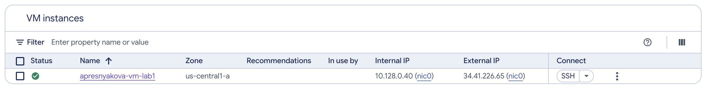
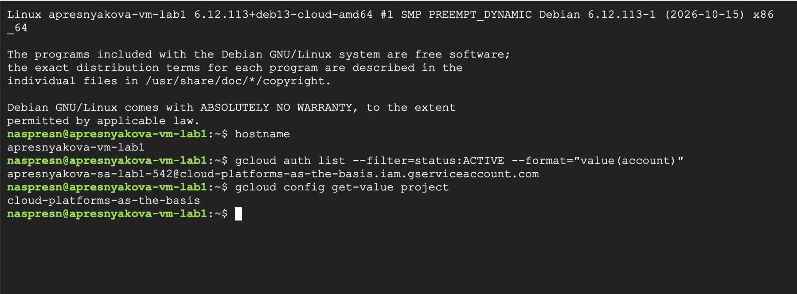
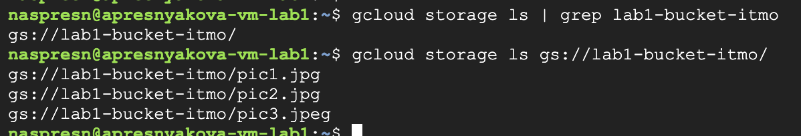
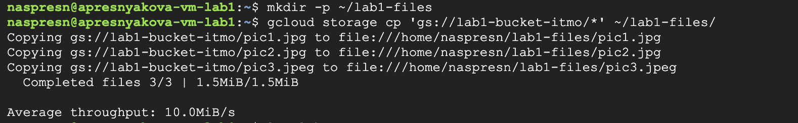
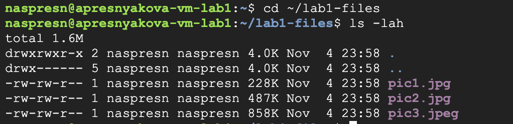
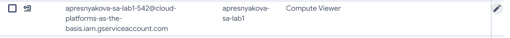
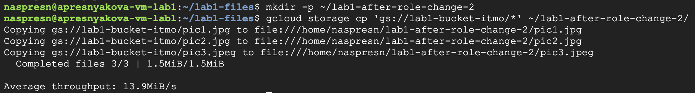
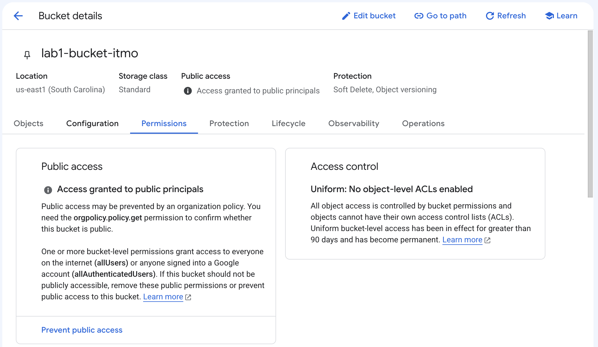

University: [ITMO University](https://itmo.ru/ru/)<br>
Faculty: [FICT](https://fict.itmo.ru)<br>
Course: [Cloud platforms as the basis of technology entrepreneurship](https://ex-itmo-ict-faculty.github.io/cloud-platforms-as-the-basis-of-technology-entrepreneurship/)<br>
Year: 2026/2027<br>
Group: U4225<br>
Author: Presnyakova Anastasia Alekseevna<br>
Lab: Lab1<br>
Date of create: 05.11.2026<br>
Date of finished:

# Лабораторная работа №1. Обзор Google Cloud и исследование основных сервисов

## Цель работы

Ознакомиться с основными возможностями Google Cloud, изучить управление доступом через IAM, создать виртуальную машину Compute Engine и выполнить копирование файлов из Cloud Storage.

## Ход работы

### 1. Создание сервисного аккаунта

В разделе **IAM & Admin → Service Accounts** был создан сервисный аккаунт со следующими параметрами:

- имя: `apresnyakova-sa-lab1`;
- адрес: `apresnyakova-sa-lab1-542@cloud-platforms-as-the-basis.iam.gserviceaccount.com`;
- первоначальная роль: `Storage Admin`.

Роль `Storage Admin` предоставляет права для работы с объектами Cloud Storage. Созданный аккаунт далее использовался виртуальной машиной.

### 2. Создание виртуальной машины

В Compute Engine была создана виртуальная машина:

- имя: `apresnyakova-vm-lab1`;
- зона: `us-central1-a`;
- тип машины: `e2-micro`;
- режим предоставления ресурсов: `Spot`;
- операционная система: Debian GNU/Linux;
- сервисный аккаунт: `apresnyakova-sa-lab1`.

После запуска у виртуальной машины появился статус **Running**.



Подключение к VM было выполнено через SSH в Google Cloud Console. Команда `hostname` подтвердила имя машины. Также были проверены активный сервисный аккаунт и текущий проект:

```bash
hostname
gcloud auth list --filter=status:ACTIVE --format="value(account)"
gcloud config get-value project
```

В результате были получены имя `apresnyakova-vm-lab1`, адрес созданного сервисного аккаунта и проект `cloud-platforms-as-the-basis`.



### 3. Копирование файлов из Cloud Storage

С помощью утилиты `gcloud` был найден учебный бакет `lab1-bucket-itmo`, после чего выведен список его объектов:

```bash
gcloud storage ls | grep lab1-bucket-itmo
gcloud storage ls gs://lab1-bucket-itmo/
```

В бакете находились три файла: `pic1.jpg`, `pic2.jpg` и `pic3.jpeg`.



Для файлов была создана локальная папка на виртуальной машине. Затем все три объекта были скопированы из бакета:

```bash
mkdir -p ~/lab1-files
gcloud storage cp 'gs://lab1-bucket-itmo/*' ~/lab1-files/
```

Команда завершилась успешно и сообщила о копировании трёх файлов.



Наличие файлов на VM было проверено командами:

```bash
cd ~/lab1-files
ls -lah
```

В локальной папке отобразились все три файла с общим объёмом около 1,6 МБ.



### 4. Изменение роли и повторная проверка доступа

В разделе IAM роль сервисного аккаунта была изменена с `Storage Admin` на `Compute Viewer`.



После изменения роли была создана новая локальная папка и повторена команда копирования:

```bash
mkdir -p ~/lab1-after-role-change-2
gcloud storage cp 'gs://lab1-bucket-itmo/*' ~/lab1-after-role-change-2/
```

Несмотря на отсутствие роли `Storage Admin`, все три файла снова были успешно скопированы.



Для определения причины были проверены разрешения бакета. В Google Cloud Console указано, что доступ предоставлен публичным субъектам. При этом для бакета используется единый контроль доступа на уровне бакета.



Таким образом, чтение объектов было разрешено политикой самого бакета для `allUsers` или `allAuthenticatedUsers`. Роль `Compute Viewer` не предоставляет доступ к Cloud Storage, однако в данном случае файлы оставались доступными благодаря публичным разрешениям бакета.

### 5. Удаление созданных ресурсов

После завершения проверки были удалены созданная виртуальная машина `apresnyakova-vm-lab1` и сервисный аккаунт `apresnyakova-sa-lab1`.

## Выводы

В ходе лабораторной работы был изучен интерфейс Google Cloud Console, создан сервисный аккаунт и запущена виртуальная машина Compute Engine типа `e2-micro` в режиме Spot. Через `gcloud` были найдены и скопированы на VM три файла из Cloud Storage.

Изменение роли с `Storage Admin` на `Compute Viewer` показало, что итоговый доступ зависит не только от роли сервисного аккаунта, но и от политики ресурса. Файлы продолжили копироваться из-за публичных разрешений учебного бакета. После выполнения работы созданные ресурсы были удалены.
