University: [ITMO University](https://itmo.ru/ru/)<br>
Faculty: [FICT](https://fict.itmo.ru)<br>
Course: [Cloud platforms as the basis of technology entrepreneurship](https://ex-itmo-ict-faculty.github.io/cloud-platforms-as-the-basis-of-technology-entrepreneurship/)<br>
Year: 2026/2027<br>
Group: U4225<br>
Author: Presnyakova Anastasia Alekseevna<br>
Lab: Lab2<br>
Date of create: 05.11.2026<br>
Date of finished: 05.11.2026

# Лабораторная работа №2. Исследование Cloud Run

## Цель работы

Ознакомиться с работой Cloud Run, развернуть тестовый контейнер, проверить его логи и метрики, создать несколько ревизий и изучить распределение трафика между ними.

## Ход работы

### 1. Создание сервиса Cloud Run

В проекте `cloud-platforms-as-the-basis` был создан сервис Cloud Run со следующими параметрами:

- имя: `apresnyakova-run-lab2`;
- регион: `europe-west1`;
- образ: `us-docker.pkg.dev/cloudrun/container/hello`;
- доступ: публичный;
- модель оплаты: по запросам.

Для запуска был выбран готовый тестовый контейнер Hello. Cloud Run автоматически управляет количеством экземпляров и при отсутствии запросов может уменьшить их число до нуля.

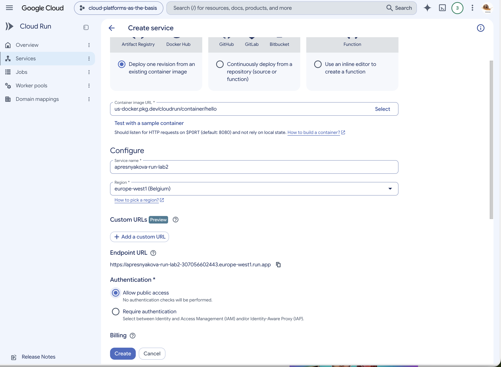

После создания сервис и первая ревизия были успешно запущены. Весь трафик был направлен на ревизию `apresnyakova-run-lab2-00001-fpw`.

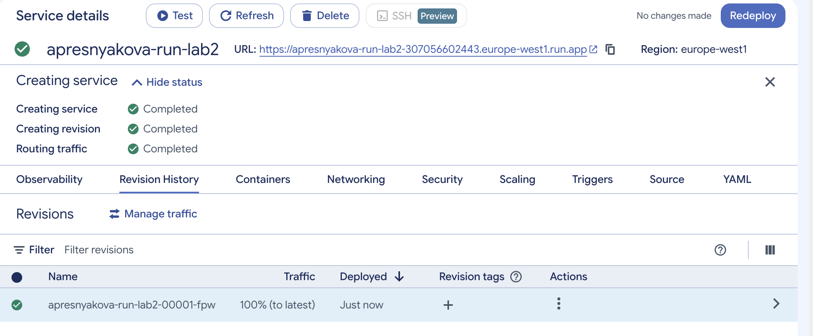

### 2. Проверка работы сервиса

Для сервиса был сформирован публичный URL:

```text
https://apresnyakova-run-lab2-307056602443.europe-west1.run.app
```

При переходе по ссылке открылась тестовая страница **It's running!**. На странице были указаны имя первой ревизии, регион и проект.

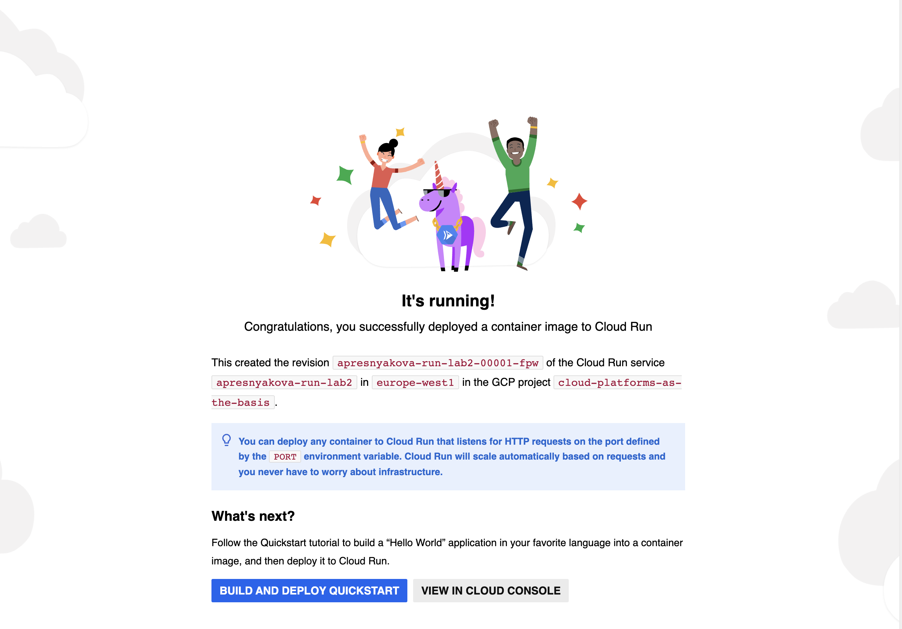

### 3. Анализ метрик и логов

Во вкладке **Observability → Metrics** были изучены показатели работы сервиса. Запросы завершались с кодами `2xx`, задержка составляла примерно 5–15 мс, а количество контейнерных экземпляров изменялось от 0 до 1. Это показывает, что сервис успешно обрабатывал запросы и автоматически масштабировался.

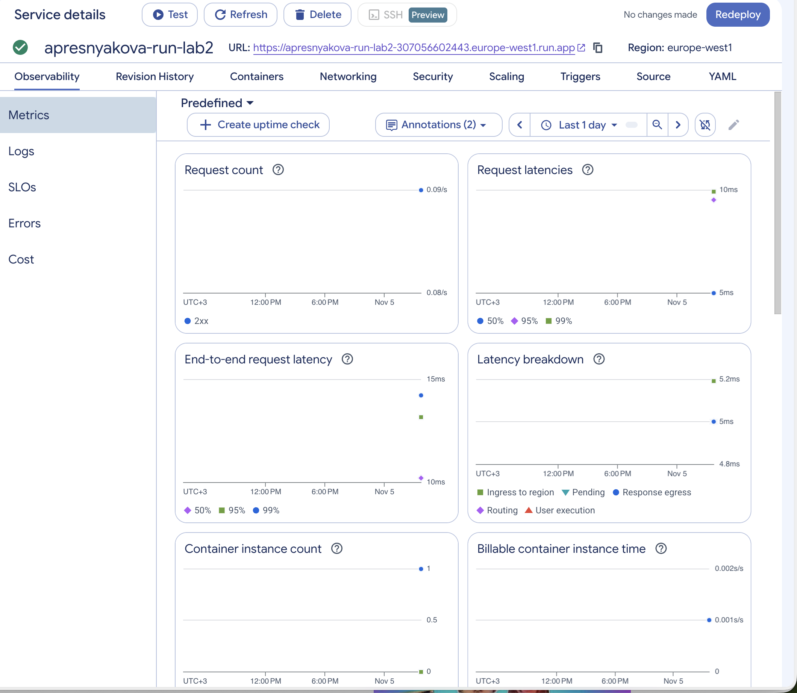

Во вкладке **Observability → Logs** отображались системные события создания сервиса и запуска контейнера. В логах было указано, что контейнер начал принимать HTTP-запросы на порту `8080`, startup-проверка завершилась успешно, а запросы `GET` возвращали код `200`.

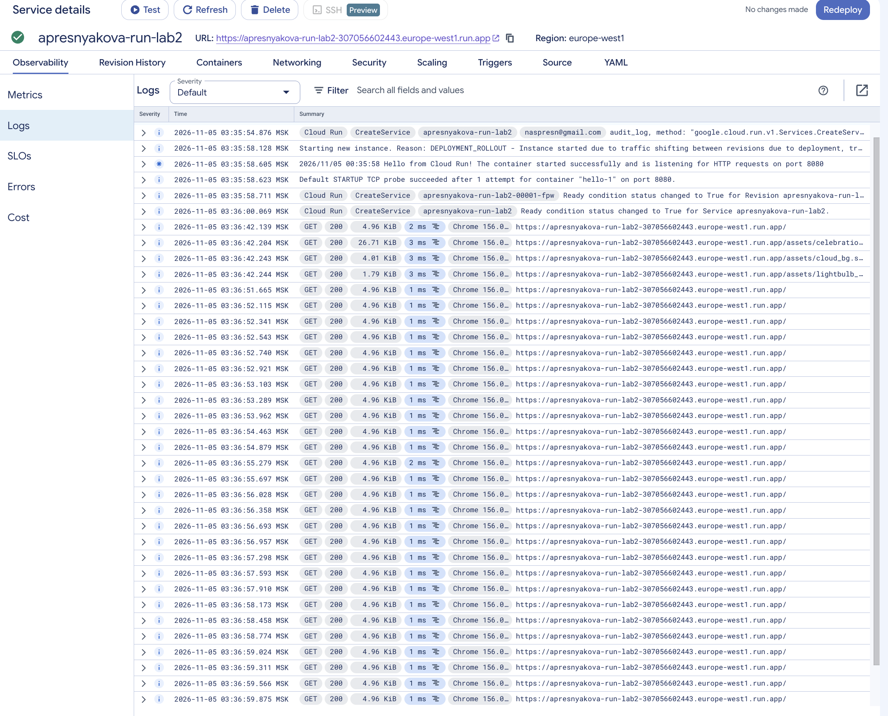

### 4. Создание ревизии с портом 8090

В настройках контейнера порт был изменён с `8080` на `8090`. Другие параметры сервиса не менялись.

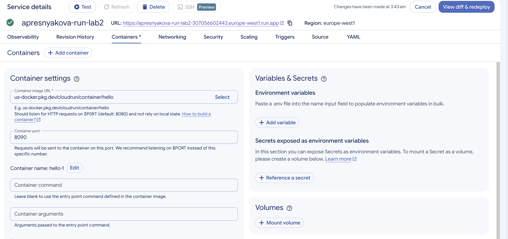

Перед повторным развёртыванием Cloud Run показал сравнение конфигураций, в котором единственным изменением был номер порта.

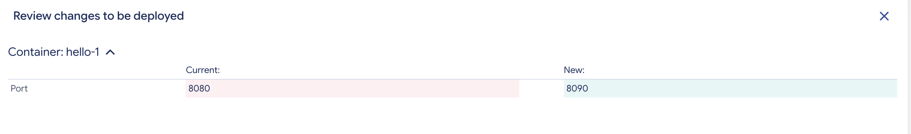

После развёртывания была создана вторая ревизия `apresnyakova-run-lab2-00002-nsk`. Она успешно запустилась на порту `8090` и получила 100% трафика.

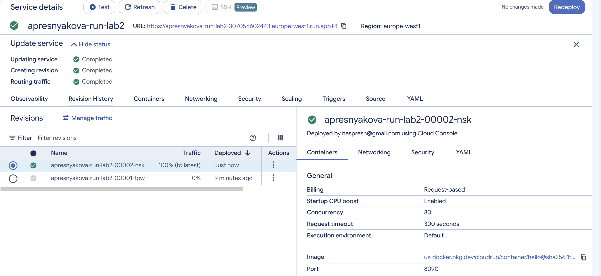

Проверка по тому же URL показала работающую страницу второй ревизии.

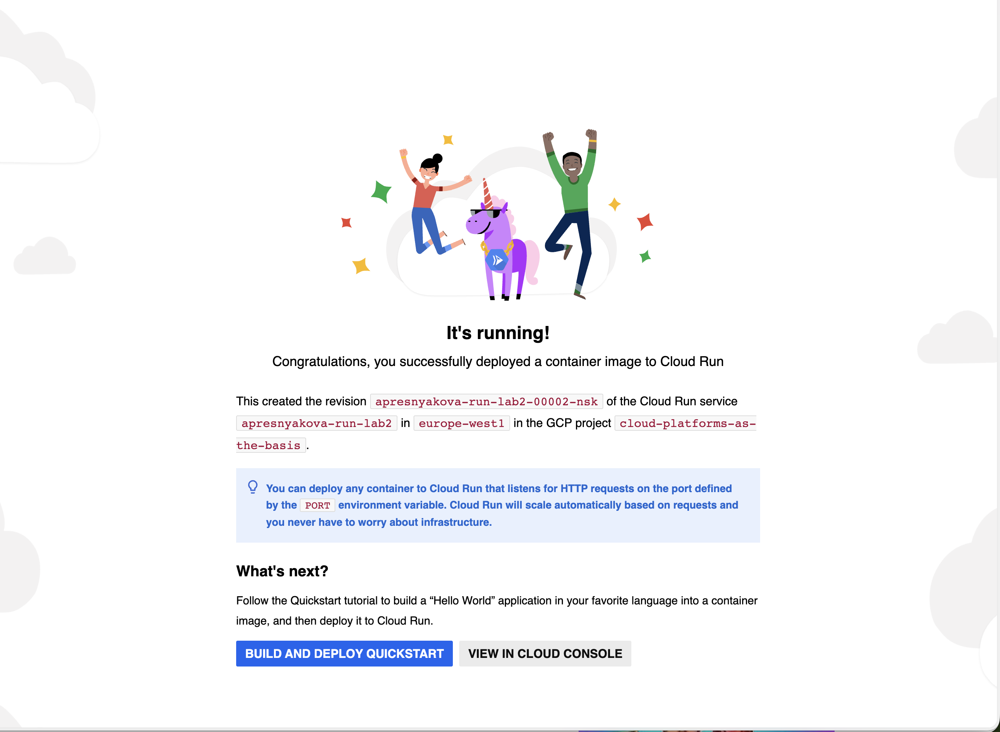

Тестовый контейнер продолжил работать, поскольку он использует переменную окружения `$PORT`, которую Cloud Run устанавливает в соответствии с настройкой контейнера.

### 5. Переключение трафика между ревизиями

Сначала 100% трафика было вручную направлено на первую ревизию `00001-fpw`, а вторая ревизия получила 0%.

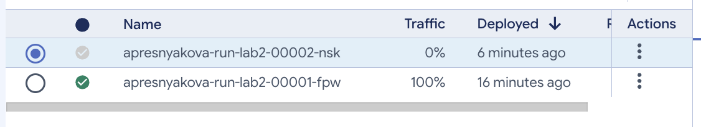

После обновления страницы сервис снова показал имя первой ревизии. Обе версии возвращали одинаковую страницу, поскольку использовали один образ и различались только значением порта.

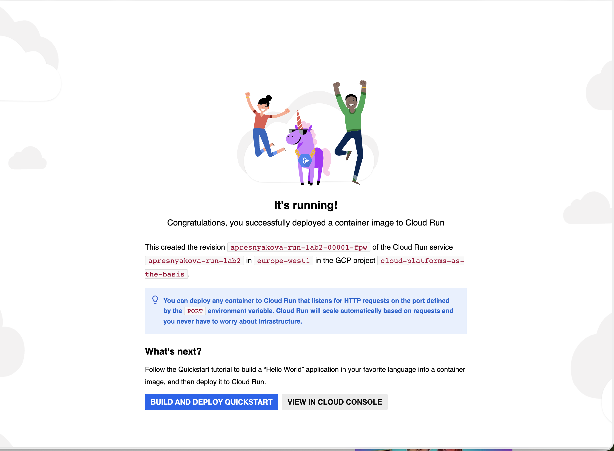

Затем трафик был распределён поровну: по 50% на каждую ревизию.

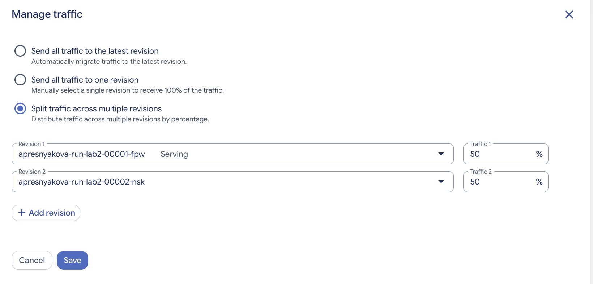

История ревизий подтвердила применение распределения 50/50.

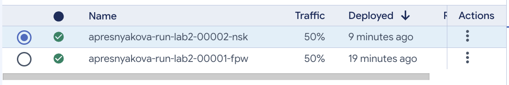

### 6. Удаление созданных ресурсов

После завершения проверки сервис `apresnyakova-run-lab2` был удалён вместе с созданными ревизиями.

## Выводы

В ходе лабораторной работы был создан и проверен публичный сервис Cloud Run. Метрики и логи позволили увидеть успешные HTTP-запросы, время ответа, запуск контейнера и автоматическое изменение количества экземпляров.

Изменение порта с `8080` на `8090` создало новую ревизию. Она продолжила работать, поскольку тестовый контейнер использует значение переменной `$PORT`. Переключение трафика показало, что Cloud Run позволяет направлять запросы на одну выбранную ревизию или распределять их между несколькими версиями в заданных пропорциях. После выполнения работы сервис был удалён.
