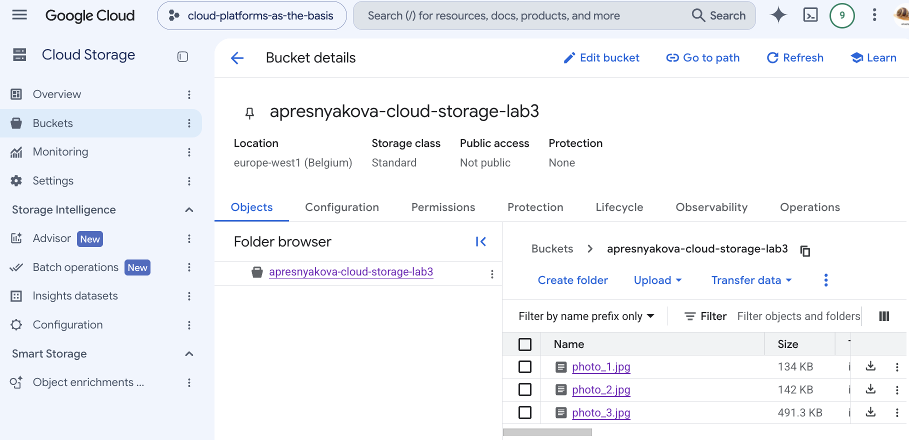
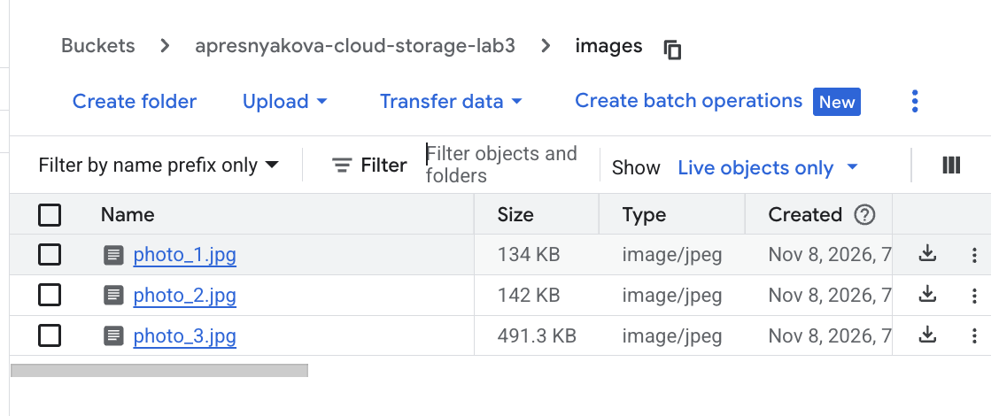
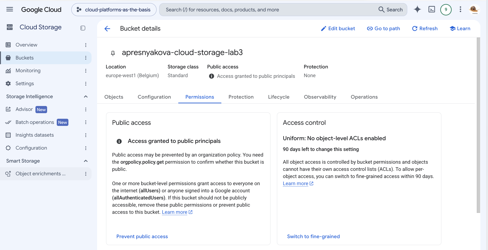

University: [ITMO University](https://itmo.ru/ru/)<br>
Faculty: [FICT](https://fict.itmo.ru)<br>
Course: [Cloud platforms as the basis of technology entrepreneurship](https://ex-itmo-ict-faculty.github.io/cloud-platforms-as-the-basis-of-technology-entrepreneurship/)<br>
Year: 2026/2027<br>
Group: U4225<br>
Author: Presnyakova Anastasia Alekseevna<br>
Lab: Lab3<br>
Date of create: 08.11.2026<br>
Date of finished: 08.11.2026

# Лабораторная работа №3. Исследование Cloud Storage

## Цель работы

Ознакомиться с работой объектного хранилища Cloud Storage: создать бакет, загрузить и упорядочить объекты, настроить публичное чтение файлов и проверить доступ по прямой ссылке.

## Ход работы

### 1. Создание бакета

В проекте `cloud-platforms-as-the-basis` был создан бакет со следующими параметрами:

- имя: `apresnyakova-cloud-storage-lab3`;
- регион: `europe-west1`;
- класс хранения: `Standard`;
- управление доступом: `Uniform`;
- шифрование: ключ Google-managed;
- защита от публичного доступа: выключена;
- Soft Delete, Object Versioning и Retention: выключены.

Класс `Standard` подходит для данных, которые используются часто. Режим `Uniform` означает, что доступ к объектам управляется разрешениями бакета.

### 2. Загрузка изображений

В бакет были загружены три изображения:

- `photo_1.jpg`;
- `photo_2.jpg`;
- `photo_3.jpg`.

После загрузки бакет оставался приватным.



### 3. Создание папки и перемещение объектов

В бакете была создана папка `images`, после чего в неё были поочерёдно перемещены все три изображения.



В объектном хранилище такая папка представляет собой часть имени объекта. Например, полное имя первого файла имеет вид `images/photo_1.jpg`.

### 4. Настройка публичного доступа

На уровне бакета был добавлен публичный участник `allUsers` с ролью `Storage Object Viewer`. Эта роль разрешает пользователям интернета просматривать и скачивать объекты, но не позволяет изменять или удалять их.

После применения разрешения Cloud Storage показал, что доступ предоставлен публичным субъектам.



### 5. Проверка публичной ссылки

Через контекстное меню файла `photo_1.jpg` была получена публичная ссылка:

```text
https://storage.googleapis.com/apresnyakova-cloud-storage-lab3/images/photo_1.jpg
```

Изображение успешно открылось напрямую в браузере без перехода в Google Cloud Console.


### 6. Удаление созданных ресурсов

После завершения проверки изображения и бакет `apresnyakova-cloud-storage-lab3` были удалены. Публичная ссылка после удаления ресурса больше не работает.

## Выводы

В ходе лабораторной работы был создан бакет Cloud Storage, в него были загружены и упорядочены изображения. Было изучено управление доступом на уровне бакета и настроено публичное чтение объектов с помощью роли `Storage Object Viewer` для участника `allUsers`.

Проверка прямой ссылки показала, что публичный объект можно открыть без авторизации. После выполнения задания созданные ресурсы были удалены.
