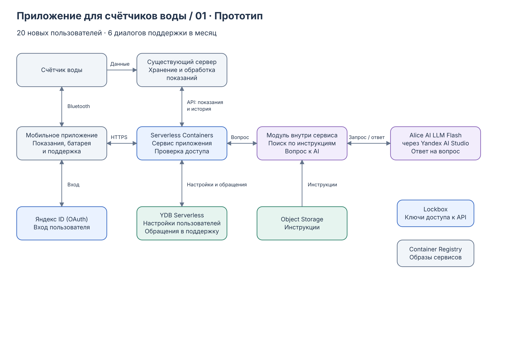
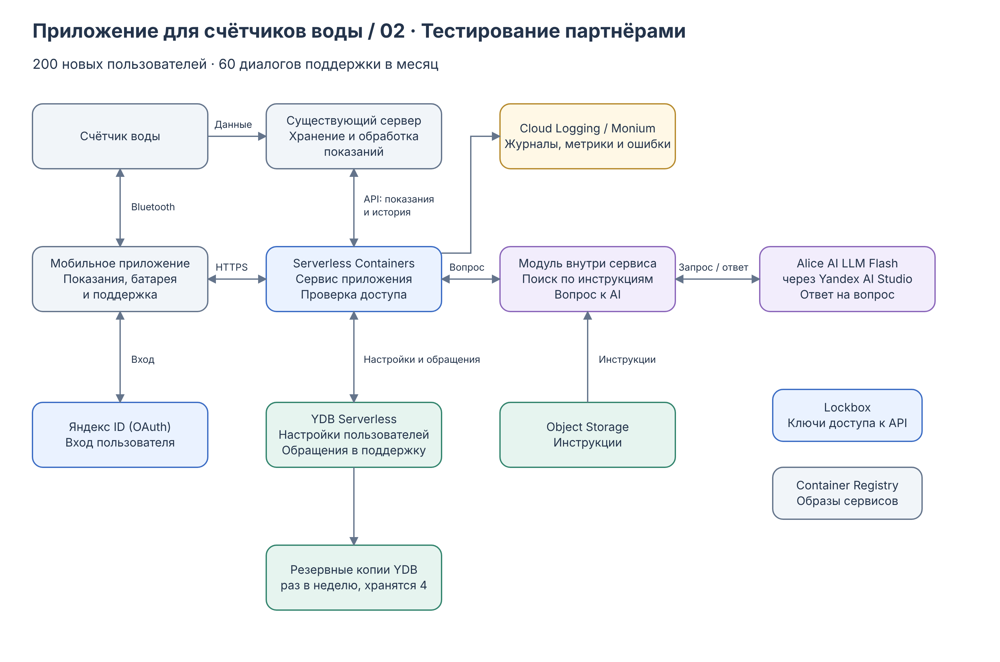
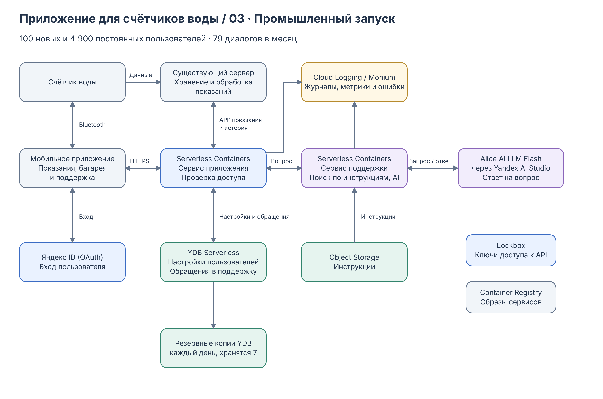

University: [ITMO University](https://itmo.ru/ru/) 
Faculty: [FICT](https://fict.itmo.ru) 
Course: [Cloud platforms as the basis of technology entrepreneurship](https://ex-itmo-ict-faculty.github.io/cloud-platforms-as-the-basis-of-technology-entrepreneurship/) 
Year: 2026/2027 
Group: U4225 
Author: Presnyakova Anastasia Alekseevna 
Lab: Lab4 
Date of create: 08.11.2026 
Date of finished: 09.11.2026

# Лабораторная работа №4. Разработка инфраструктуры MVP AI-приложения

## Цель работы

Подобрать облачные сервисы для приложения с AI, составить схемы для трёх этапов развития и оценить расходы.

## Ход работы

### 1. Идея приложения

Для работы я выбрала приложение для владельцев счётчиков воды. Идея связана с проектом, над которым я планирую работать в будущем на своей работе. В приложении можно посмотреть показания, историю расхода и заряд батареи, считать данные по Bluetooth и обратиться в поддержку.

Показания уже хранятся и обрабатываются на существующем сервере. Приложение получает их через API. Создавать ещё одно хранилище измерений для него не требуется.

AI используется в чате поддержки: объясняет, как подключить счётчик, где найти показания и что делать при возникновении ошибки. Ответ составляется по инструкции к устройству. Если ответа в инструкции нет, пользователь может оставить обращение сотруднику.

### 2. Выбор облачных сервисов

Приложение рассчитано на российских пользователей, поэтому для него важно использовать российские облачные сервисы. В приложении хранятся настройки пользователей и их обращения в поддержку, а закон о персональных данных требует хранить такие данные граждан России в базах на территории России. Кроме того, оплата российских сервисов производится в рублях без сложностей с зарубежными платежами.

Среди российских облаков выбран Yandex Cloud. В нём есть все сервисы, нужные приложению: бессерверные контейнеры, база данных, хранилище файлов и собственные языковые модели Яндекса. Все сервисы размещаются в регионе Россия.

| Сервис | Для чего нужен |
|---|---|
| Serverless Containers | Выполняет запросы приложения к существующему API и обслуживает чат поддержки. Запускается при обращении и может останавливаться при простое. |
| Яндекс ID (OAuth) | Обеспечивает вход пользователя. |
| YDB Serverless | Хранит настройки пользователей и обращения в поддержку. Оплата зависит от числа операций. |
| Object Storage | Хранит инструкции для AI-помощника. |
| Alice AI LLM Flash (Yandex AI Studio) | Формирует ответы на вопросы по инструкциям. |
| Lockbox | Защищённое хранилище секретов: в нём лежат ключи доступа к API. |
| Container Registry | Хранит образы сервисов. |

Доступ к показаниям проверяется на стороне сервера: пользователь должен видеть только свои устройства. При редких посещениях нет смысла постоянно держать виртуальную машину, а готовая модель позволяет не обучать и не обслуживать собственную.

### 3. Развитие инфраструктуры

**Начальный этап.** Для прототипа достаточно одного сервиса в Serverless Containers: он получает показания через API и обрабатывает вопросы к AI. Это позволяет проверить основные функции с небольшими расходами.

**Тестирование партнёрами (пилотный запуск).** Приложение используется ограниченной группой участников. Основные сервисы сохраняются. Добавляются резервные копии базы раз в неделю в дополнение к двум бесплатным автоматическим копиям YDB и наблюдение за ошибками через Cloud Logging и Monium. По отзывам участников можно дополнить инструкции помощника.

**Промышленный запуск.** Поддержка выносится в отдельный сервис Serverless Containers, чтобы её ресурсы и ограничения можно было менять отдельно от просмотра показаний. Резервные копии базы делаются каждый день и хранятся 7 дней. Число экземпляров контейнеров увеличивается по мере поступления запросов.

Все три схемы находятся в [файле draw.io](diagrams/architecture.drawio).

### 4. Оценка расходов

В расчёте разделены новые и постоянные пользователи. Для новых принято три посещения в месяц, для постоянных одно. Условно 30% новых и 1% постоянных пользователей начинают по одному диалогу поддержки. На этапах прототипа и пилота все участники знакомятся с приложением впервые. После запуска из 5 000 пользователей принято 100 новых за месяц и 4 900 постоянных.

| За месяц | Прототип | Тестирование партнёрами | Промышленный запуск |
|---|---:|---:|---:|
| Новые / постоянные пользователи | 20 / 0 | 200 / 0 | 100 / 4 900 |
| Посещения приложения | 60 | 600 | 5 200 |
| Запросы приложения, по 10 на посещение | 600 | 6 000 | 52 000 |
| Диалоги поддержки | 6 | 60 | 79 |
| Ответы AI, по 5 на диалог | 30 | 300 | 395 |

Например, после запуска: `100 × 3 + 4 900 × 1 = 5 200` посещений и `100 × 30% + 4 900 × 1% = 79` диалогов в месяц. Доли новых пользователей и обращений приняты для оценки расходов.

Тарифы Yandex Cloud указаны в рублях с НДС. Расходы за месяц в рублях:

| Статья | Прототип | Тестирование партнёрами | Промышленный запуск |
|---|---:|---:|---:|
| Serverless Containers | 0,92 | 9,22 | 43,28 |
| Alice AI LLM Flash | 21,60 | 216,00 | 284,40 |
| База YDB | 0,62 | 6,16 | 51,22 |
| Резервные копии YDB | 0,00 | 13,84 | 113,02 |
| Хранение файлов, образов и секретов | 29,19 | 29,20 | 29,20 |
| Итого | **52,33** | **274,42** | **521,12** |
| Запас 30% | 15,70 | 82,33 | 156,34 |
| Плановый бюджет, округление вверх до сотен | **100** | **400** | **700** |

Допущения расчёта:

- Обычный запрос приложения обрабатывается 0,2 секунды, ответ AI занимает 8 секунд. Контейнер использует 1 vCPU и 0,5 ГБ памяти. На промышленном этапе при ответе AI работают оба контейнера.
- Один ответ AI содержит 6 000 входных и 600 выходных токенов. При цене 0,10 и 0,20 ₽ за 1 000 токенов это `(6 000 × 0,10 + 600 × 0,20) / 1 000 = 0,72` рубля. Для 395 ответов получается `395 × 0,72 = 284,40` рубля.
- База YDB оплачивается по числу операций. Принято около 20 операций на запрос приложения и около 100 на ответ AI.
- Резервные копии по требованию сохраняются в Object Storage: раз в неделю с хранением 4 копий на втором этапе и каждый день с хранением 7 копий на третьем. Создание копии оплачивается по объёму данных, округлённому вверх до 1 ГБ, поэтому копии стоят дороже самой базы. Две автоматические копии YDB бесплатны и в расчёт не входят.
- Бесплатные квоты (например, 1 млн RU в месяц в YDB) не вычитались. Вход через Яндекс ID бесплатный, журналы и метрики предполагаются в пределах бесплатных квот. Сборка образов, существующий сервер и разработка приложения в расчёт не входят.

Тарифы: [Serverless Containers](https://yandex.cloud/ru/docs/serverless-containers/pricing), [Yandex AI Studio](https://aistudio.yandex.ru/ru/docs/ai-studio/pricing), [YDB](https://yandex.cloud/ru/docs/ydb/pricing/serverless), [Object Storage](https://yandex.cloud/ru/docs/storage/pricing), [Lockbox](https://yandex.cloud/ru/docs/lockbox/pricing), [Container Registry](https://yandex.cloud/ru/docs/container-registry/pricing).

## Выводы

В ходе работы были составлены три схемы инфраструктуры приложения с AI-поддержкой на российских облачных сервисах, подобраны сервисы и оценены расходы для каждого этапа. На первом этапе достаточно одного сервиса приложения, а по мере развития добавляются резервное копирование, наблюдение за ошибками и отдельный сервис поддержки. Использование готового API показаний, запуск контейнеров по запросу и выбор лёгкой AI-модели позволяют снизить расходы.
